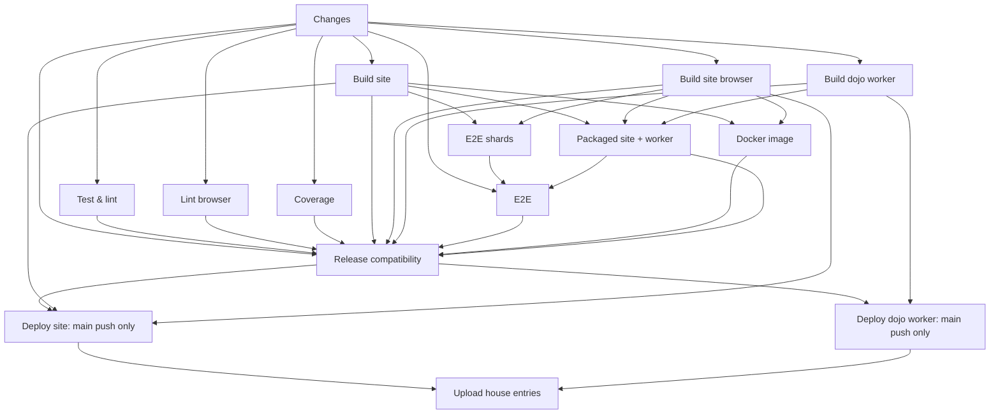

# Packaged compatibility gate

`Packaged site + worker` runs on every code PR and main push, using the same commit's
`site-server`, `site-browser`, and `dojo` artifacts. It builds `Dockerfile.prebuilt` and
`dojo/Dockerfile.prebuilt`, including the pinned production proof checkers. It needs no
credentials. Documentation-only PRs skip the builds deliberately.

`Release compatibility` waits for the site and worker builds, Test & lint, browser lint,
Coverage, E2E, Docker image, and the packaged smoke. Both deployment jobs depend on it
and still run **only on pushes to main**. Failed, cancelled, unexpectedly skipped, or
missing prerequisites fail this gate. The existing six required check names are
preserved. Required `E2E` now checks both browser shards and the packaged smoke, so
packaged failures also block merging under current branch protection. `Packaged
site + worker`, `Build dojo worker` on PRs, and `Release compatibility` are additional
checks. Both deployments depend on the shared release gate. Website doctests also
run in Test & lint, alongside the existing library doctests.



The smoke makes two concrete assertions:

1. The packaged worker runs the committed MiniSat WASM as uid 10001, with no network,
   on a deterministic two-formula archive. A checked SAT model and an UNSAT DRAT proof
   must both count as solved. `--checker verified` requires the image's real drat-trim
   and cake_lpr; no built-in fallback is allowed. The CLI also exits zero for wrong or
   unsolved answers, so the harness checks each formula and both result totals.
2. The packaged production site migrates a disposable local database. Only an old
   account and session are seeded directly, as in the browser fixture. A real multipart
   HTTP upload creates a tiny community benchmark. The worker is briefly paused so the
   harness can inspect the real dispatch claim and verify that neither an incorrect
   token nor the shared dispatch token can post a callback. The claim deadline is 45
   seconds: a submit racing startup can miss the immediate dispatch and must wait
   for the production dispatcher’s next 30-second tick. After unpausing, the real
   worker must settle the benchmark and post its job-token callback: the database must
   contain exactly `refused / too_easy`, one attempt, and a retired job token. A replay
   using the retired token must fail without changing the result. Invalid dispatch
   credentials must also be refused by the worker.

This is a bounded smaller gate, **not a completed solver-to-leaderboard roundtrip**.
Production `/jobs` always generates/evaluates the full hidden season; it does not accept
an arbitrary tiny set or a reduced budget. Injecting synthetic hidden-set cache entries
would misrepresent that boundary. The supported `dojo run --set` protocol exercises the
packaged sandbox and proof pipeline separately; the community benchmark exercises real
site dispatch, rules agreement, callback authentication, and persisted status. Tiny
benchmarks are deliberately refused before the community proof-checking path, so its
callback does not prove UNSAT. The separate worker CLI assertion supplies that check.
Solver `Finished` reports, stored solver score/results and leaderboard placement remain
covered by existing native service tests, not by this packaged smoke. Pool transfer,
season export, Fly/Turso networking, browser hydration, HTTPS cookie enforcement, and
atomic deployment of both services are also outside this gate. Successful gates do not
prevent a later Fly deployment failure from leaving different app versions running.

## Running and diagnosing

Prerequisites: Linux, Python 3.10+, Docker with a working daemon, and matching production
artifacts unpacked into `dist/hashi`, `dist/hash.txt`, `dist/site/`, and `dist/dojo`.
The parent or CI owns these release/image builds; do not run them alongside memory-heavy
agent builds. With those prerequisites available:

```sh
docker build --file Dockerfile.prebuilt --tag hashi-packaged-site .
docker build --file dojo/Dockerfile.prebuilt --tag hashi-packaged-worker .
python3 scripts/packaged-smoke.py --site-image hashi-packaged-site \
  --worker-image hashi-packaged-worker --logs packaged-logs/smoke
```

The log directory must be new. Missing tools, daemon, images, checkers, or artifacts fail;
the harness never builds, pulls, skips, uses host binaries, or inherits host app settings.
Docker containers receive only explicit test configuration and public test tokens.
The site binary runs as the invoking user's uid/gid so Python can inspect its SQLite
files; the worker server retains its production entry point and privilege drop. Hosts
publish only ephemeral loopback ports. Container traffic uses a unique bridge network;
the solver-only container has no network. Docker's internal-network mode does not publish
the host ports needed by this HTTP harness.
Every subprocess has a deadline, HTTP sockets have timeouts, polls have explicit limits, and `finally`
collects logs and removes containers/network even after a failed assertion. A forced CI
cancellation can bypass cleanup; the hosted runner is disposable. CI caps image builds
and the entire job, and uploads `packaged-compatibility` logs even on failure. The JSON
result contains no job/session tokens; logs may contain public test-only identifiers.

Fast harness checks (fixture truth via exhaustive enumeration, deterministic archives,
false-green result rejection, polling deadlines, cleanup after removal failure):

```sh
python3 -m unittest discover -s scripts/tests -p 'test_packaged_smoke.py' -v
```

These Python tests do not run the images. A passing packaged CI job is required to claim
the image/proof-checker or cross-service roundtrip was validated.
